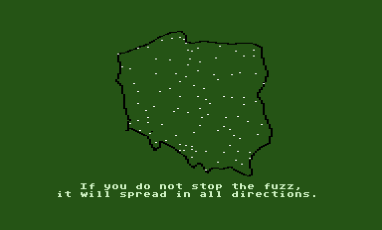
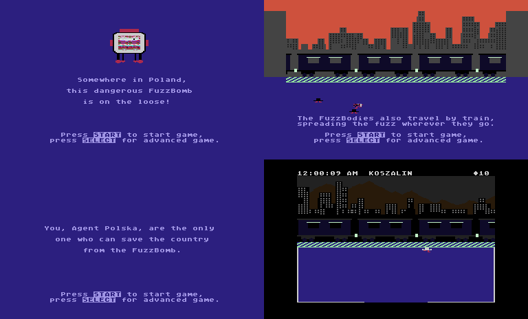

# Agent Polska

*Agent USA* (1984, Scholastic Wizware) with 100 Polish cities and a map of
Poland. The game code is the original; only its data is replaced.
`make_polska.py` reads `../agent/Agent USA (1984)(Scholastic Wizware)(US).xex`
and writes `agent-polska.xex`. The disassembly in `../agent/decompiled` is
not touched.

```sh
./run.sh                # rebuild agent-polska.xex and run it in Altirra
python3 make_polska.py  # only rebuild
```

## What changes

| Game data (see `../agent/decompiled/agent.asm`) | Agent Polska |
|---|---|
| `map_rle` – the US map | Outline of Poland |
| `city_names` – 100 US cities | 100 Polish cities, upper case, without Polish letters (ŁÓDŹ → LODZ) |
| `city_xy` | Real positions of the cities on the map |
| `city_links` – the rail network | Generated network (below) |
| `city_flags` bit 7 – InfoBooth in state capitals | InfoBooth in the 18 voivodeship seats |
| `city_station` – time zone, station layout | One time zone for all; bigger cities have bigger stations with more people |
| `city_left/right/up/down` – InfoBooth joystick | Nearest city in each direction |
| Story texts | "Somewhere in Poland", "Agent Polska", "voivodeship seat" |

The cities, the outline and the rail network are the same as in the
Agent Polska atlas (`../agent/web`); `make_polska.py` imports
`../agent/web/generate_data.py`.

- **Express trains** link the big cities (over 150,000 people); closer pairs
  are more likely, and Warsaw is the hub. In the game they are "special"
  links: you need a ticket to board, and the fuzz does not spread along
  them.
- **Regional trains** link every city to its 2-4 nearest neighbours.
- Each destination has two departures in the 16 timetable slots. The ride
  length follows the distance; express trains are faster.

The ticket counter accepts letters, digits, space, comma and full stop, and
at most 18 characters. So hyphens became spaces (BIELSKO BIALA,
KEDZIERZYN KOZLE), and five long names are shortened: GORZOW WLKP.,
OSTROW WLKP., OSTROWIEC SW., PIOTRKOW TRYB., TOMASZOW MAZ. The counter takes
the first city in the list that the typed text starts with. So RADOMSKO and
SZCZECINEK come before RADOM and SZCZECIN.

With a single time zone, the "You have travelled from the ... time zone"
message never appears.




