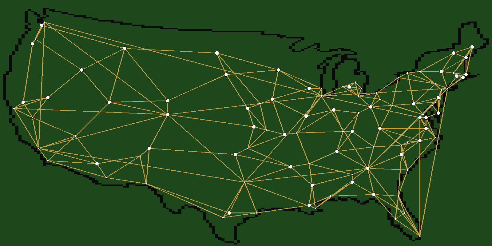
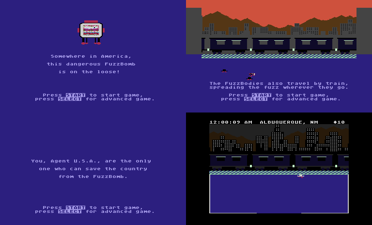

# Agent USA (1984, Scholastic Wizware) — disassembled

`../Agent USA (1984)(Scholastic Wizware)(US).xex` is an Atari 400/800/XL
game written in 6502 assembly. This folder holds a MADS source for it,
generated by a tracing disassembler, with names and comments added by hand.
`agent.asm` assembles back to **the original file, byte for byte**.

## The game

The FuzzBomb, a stolen TV set, travels by train between 100 American cities
and turns the people there into FuzzBodies. FuzzBodies ride the trains too,
so the fuzz spreads along the rail network. You are Agent U.S.A.:

- A FuzzBody that picks up a crystal turns back into a normal person, so
  you drop crystals in its way. If a FuzzBody touches you, you lose half
  your crystals. With none left, you become a FuzzBody yourself, the same
  as other people do.
- Crystals lie in the stations, people carry them, and the button drops one.
  A dropped crystal slowly grows more crystals around it.
- Every station has a ticket counter. Type the name of a city connected by
  rail and you get a ticket to it. The departures board shows where the
  trains go and when. Without the right ticket the conductor puts you off
  the train.
- Each of the 49 capitals (48 states and Washington, DC) has an InfoBooth.
  It has a map with city information (crystals or "FUZZED CITY"), a fuzz
  prediction (a simulation of the fuzz spreading) and the FuzzBomb's
  location.
- The clock on the status line runs in real time, in the local time zone.
  Crossing a time zone on the train moves it. The sky changes with the hour.
- You win by touching the FuzzBomb with 100 crystals. You lose when no
  crystals are left anywhere.

Keys: **START** a game, **SELECT** the advanced game (the fuzz has already
spread to 50 cities). During a game, **START** or **SELECT** freezes it
("FROZEN").

`map.png` is drawn from the game data by `tools/render.py`. It shows the map
outline (`map_rle`), every city (`city_xy`) and every rail link
(`city_links`); capitals are the large dots:

`shots.png` shows the title, two story pages and a station, taken with the
small emulator in `tools/emu.py`:

## Files

| File | What it is |
|---|---|
| `agent.asm` | MADS source: named routines, variables, tables, messages, display lists |
| `agent.xex` | Output of `build.sh`; identical to the original |
| `agent.lst` | MADS listing: address and bytes for every line |
| `map.png`, `shots.png` | The rail network drawn from the data, and screenshots |
| `tools/disasm.py` | Generates `agent.asm` from the original file |
| `tools/symbols.py` | All names, comments and tables that `disasm.py` uses |
| `tools/trace.py`, `tools/opcodes.py` | Recursive-descent code finder, 6502 opcode table |
| `tools/xex.py` | Reads the XEX and builds the RAM image the game starts with |
| `tools/verify.py` | Shows where a rebuilt XEX differs from the original |
| `tools/render.py` | Draws `map.png` (needs Pillow) |
| `tools/emu.py`, `tools/shot.py` | Headless Atari (py65, an XL OS ROM image) and the script that makes `shots.png` |
| `build.sh` | `./build.sh` assembles and compares; `./build.sh regen` regenerates the source first |

To change a name or a comment, edit `tools/symbols.py` and run
`./build.sh regen`. To change the game, edit `agent.asm` and run
`./build.sh`, which then reports where the result differs from the original.

`tools/emu.py` needs a 16 KB XL OS ROM. AltirraOS works: build it from the
Altirra sources with
`mads -d:_KERNEL_XLXE=1 -s -p -i:source/Shared -i:autobuild -b:$c000 -o:kernelxl.rom source/main.xasm`
in `src/Kernel`. The emulator draws each scanline with the registers as they
are at that moment, so DLI colour and font changes show. It has no sound, no
collisions and no fine scrolling.

## How the original file works

There is no compression. The file was made from a memory dump of the running
game. `$2CFA` still holds an XEX header for `$2D1E-$7F9F`, and `$2A20` holds
old screen text.

1. One segment loads `$21FF-$B87F`. A 1-byte segment then writes `$A7` to
   `$0000`, which nothing uses.
2. RUN `$2AA0` (`LoaderStub`) clears `$0400-$21FF` and copies `$2200-$2AFF`
   down to `$0800`.
3. `ClearStub` at `$B800` clears `$1010-$2A1F` and jumps to `Start`
   (`$2D1E`).

So `$2200-$2A0F` of the file is the game's `$0800-$100F`. `agent.asm`
assembles that part with `org r:$0800`. MADS would write a header for every
`org`, so the source uses `opt h-` and writes the segment headers itself.

## Memory map (while the game runs)

| Address | Contents |
|---|---|
| `$0080-$00FF` | Zero page: room window (`view`), DLI colours, sound pointers, collision box, pointers |
| `$0600-$06FF` | Variables: city, room, screen, clock, ticket, train, FuzzBomb, InfoBooth |
| `$0700-$073F` | Sparkles (4, a linked list) |
| `$0740-$07FF` | Objects, 16 arrays of 16: 0 scratch, 1-10 people, 11 the agent |
| `$0800-$0BFF`, `$0C00-$0FFF` | Two skyline fonts; their top holds display lists and `bit_tab` |
| `$1000-$2CFF` | Work area: station fonts, the train lines, the mode E bitmap (rooms, map), text |
| `$2D1E-$7F3E` | Code, with tables between routines (messages `$35F5`, walls `$7047`) |
| `$7FAA-$85D2` | The US map, run-length packed |
| `$85D3-$8EBF` | Shapes: pointers, sizes, graphics (people, booth, crystals, sparkles) |
| `$8EC0-$9594` | Sound effect tables and data |
| `$9595-$99C3` | Display lists and the end-of-game texts |
| `$99C4-$AA4E` | Cities: neighbours for the InfoBooth joystick, rail links, names, coordinates |
| `$AA4F-$B057` | Station and train graphics, city flags |
| `$B058-$B7FF` | Skylines (mode 4 screen data) |
| `$B800-$BFFF` | Work arrays: more object arrays, sound, cities' crystals, timetable, crystals list, status line |

## How the game works

- **Main loop** (`MainLoop`):
  - the screen's own work: the ticket counter, the InfoBooth (through
    `booth_vec`), or the agent (`AgentUpdate`, one handler per state);
  - the people (`PeopleUpdate`);
  - `DrawObjects`, which XORs every moved object out at its old place and in
    at its new one;
  - sparkles, crystals growing, and the hourly fuzz spreading.

  A console key sets `console` bit 7 and the loop then does nothing (frozen).
- **VBI** (`VBI`). It is installed as the immediate VBI and does not chain
  to the OS. It loads the display list and first DLI of `screen` from
  `dlist_tab`/`dli_tab` and sets the colours. It reads the console keys, runs
  the train, keyboard repeat and joystick, and once a second the clock
  (`EverySecond`). Then it plays the music and sound effects.
- **Screens.** `screen` selects one of 12 display lists. Stations are a mode
  E bitmap of the current room under a band of mode 4 lines: the skyline and
  the train. DLI chains change fonts and colours down the screen. The train
  is scrolled by changing the LMS addresses of its five lines and HSCROL. The
  side panels are players written straight into GRAFP0/1 (no PM DMA).
- **Stations and rooms.** A station is two rooms wide. Each room is a
  `$8F`×`$B7` window (`room_x`, `room_y`) onto station coordinates, and
  walking off an edge changes `room` (`CheckRoomExit`). Walls are
  horizontal and vertical segments (`walls`, 8 layouts chosen by
  `city_station`). Some walls are special (`HitWall`): the train door, the
  ticket window, the InfoBooth door and the FuzzBomb.
- **People.** Each one has a state (`obj_state`): walking, boarding, on a
  train, getting off, touched, turning into a FuzzBody, FuzzBody, cured.
  Once per pass one person looks for the nearest crystal (`SeekCrystal`) or
  the nearest person (`SeekPerson`, FuzzBodies). Touching passes the fuzz on;
  a FuzzBody that picks up a crystal is cured (`PickCrystal`).
- **Crystals** are a linked list (`cr_next`, `cr_xh`/`cr_xl`,
  `cr_yh`/`cr_yl`). When you leave a city, the crystals left there are
  counted into `city_crystals` (`CountCityCrystals`). Arriving shares them
  out among the new people (`SetupPeople`).
- **Trains.** Every city has 16 departure slots. Its rail links give each
  slot a destination and a journey time (`ArriveInCity`). Every 15 seconds
  the next slot comes up (`TimetableStep`) and a train runs through the
  phases of `TrainUpdate`: arrive, brake, open doors, board, leave.
  `RideTrain` shows the journey, runs the clock fast and handles the time
  zone change.
- **Fuzz and FuzzBomb.** Every game hour each fuzzed city may fuzz its rail
  neighbours (`FuzzNeighbours`). The FuzzBomb travels link by link towards a
  random goal (`MoveFuzzBomb`).
- **Text** (`PrintMsg`). Messages are a length byte and screen codes, and
  `$FF` starts a new line. Numbers are printed with the OS floating-point
  routines `IFP`/`FASC`. The ticket counter reads keys through CIO from `K:`.

## About the names

The disassembly itself is exact. The names and comments are mine, worked out
from the code and from running the game in `tools/emu.py`. They are reliable
for the engine: main loop, VBI, screens, rooms, walls, objects, crystals,
trains, clock, text, map and InfoBooth. They are less certain for some
details: the individual train phases (`Tr...`), the music envelopes
(`Mus...`) and the attract-mode demo routines (`Demo...`). Branch targets
inside routines keep generated names (`L....`), as do a few data labels
(`D....`).
