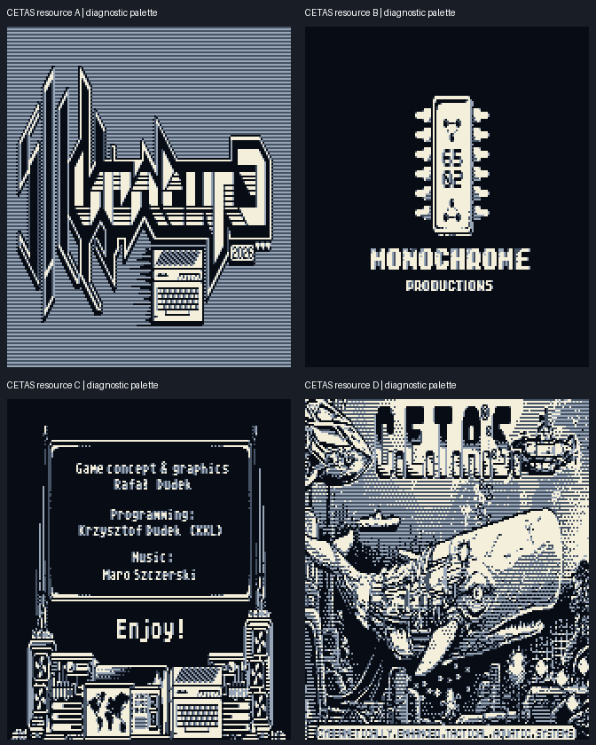

# CETAS (WIP)

The disk holds a boot loader and eight DOS files. `cetas.asm` is the game;
`intro.asm` is the introduction/loading sequence. Both are traced 6502 assembly
with some manually named routines. Run `../build.sh` to rebuild all files and
`cetas.atr`, which matches the supplied disk byte-for-byte.

| Original file | Contents | Source |
|---|---|---|
| `AUTO` | Disk loader, relocation/setup and decompressor | `loader/game.asm` |
| `XAUTORUN` | Introduction, slideshow, music and staged file loads | `intro.asm` |
| `A` | First 160×192 image, decoded at `$8010` | `a-packed.asm`, `a-unpacked.asm` |
| `B` | Second image, decoded at `$2010` | `b-packed.asm`, `b-unpacked.asm` |
| `C` | Credits image, decoded at `$4010` | `c-packed.asm`, `c-unpacked.asm` |
| `D` | CETAS title image, decoded at `$6010` | `d-packed.asm`, `d-unpacked.asm` |
| `E` | Main executable, RUNAD `$22AC` | `cetas.asm` |
| `F` | 6,480-byte graphics resource, decoded at `$A010` | `f-packed.asm`, `f-unpacked.asm` |

`boot.asm` includes the original three boot sectors at `$07C4` (entry `$07CA`).
`disk-layout.bin` preserves all non-file disk bytes, with used file payloads
zeroed. The build inserts assembled boot code and files using the saved sector
chains. `files/` contains the exact extracted originals for inspection.

## Loader and introduction

AUTO contains the disk service originally at `$1000-$13FF`; setup relocates it
to `$0800-$0BFF`. The introduction calls its file-load entry `$0806`, replacing
RUNAD with the next continuation before loading A, B, C and D. It disables the
OS ROM and installs its own NMI handler at `$0CD2`.

`CopyPicture` at `$0ECD` copies 40-byte-wide, 192-line pictures column by column
to `$8010`. Music runs from the VBI. The slideshow waits for timed intervals or
fire. It later loads F and copies 26 pages from `$A010` to `$E010` under the ROM.
That copy includes 176 bytes beyond F's 6,480-byte decoded payload; those extra
bytes are not asserted to be part of F. Finally it loads executable E.

Each compressed resource starts with its destination, a zero word and `$02`.
Recovery executes AUTO's original decompressor at `$130A`; only its file-byte
reader is hooked. All input is consumed, and backreferences must refer to
already decoded bytes. The four images each expand to 7,680 bytes.

These are rendered in a diagnostic palette. The third picture preserves the original game, programming and music credits.

## Main game structure

| Address | Meaning |
|---|---|
| `$0C00` | Object type/state array; slot 0 is the player |
| `$0C20`, `$0C40` | Object X/Y positions |
| `$0C60`, `$0C80` | Timing-related object arrays |
| `$0CA0`, `$0CC0` | Movement/state arrays; player handler stores X/Y motion here |
| `$1182-$17AF` | Music tables and player; entry jump table at `$1400` |
| `$2000`, `$201D` | NMI dispatch and vertical blank |
| `$205E` | Read joystick; direction bits become `$9B-$9E`, fire is `$9A` |
| `$22AC` | Game entry: initialize screen, music and object state |
| `$235D` | Main loop: object updates, spawn script, frame synchronization |
| `$237C`, `$23A2` | Object update scheduler and handler dispatch |
| `$24FB` | Player movement and fire |
| `$2DF5` | Object handler pointer table |
| `$2EB5` | Create player projectile, type 6 |
| `$7C00` | Display-list block |
| `$A800-$ACE3` | Additional engine/script data and code |
| `$ABE1` | Timed spawn-script interpreter, cursor `$AF/$B0` |
| `$B000-$BD1A` | Music data |

Dispatch patches the JSR operand at `$23B8/$23B9` using the object's type.
Handlers 1–18 are seeded from the table; unconfirmed roles retain `ObjectTypeNN`
names. The spawn interpreter supports delay/loop commands and a `$FA` command
that patches another JSR. Its call targets and individual enemy behaviors are
not fully annotated. Sound, collisions, full gameplay and restart have not been
validated in an Atari emulator.

`cetas.xex` and `intro.xex` preserve the original file streams. They depend on
resident loader/previous-stage memory and should not be assumed standalone;
use the complete ATR for the original loading sequence.

`graphics-resource.png` is a raw eight-byte-unit atlas of F, not proof of an
8×8 tile format. See `../analysis.json` for precise byte and instruction counts.
