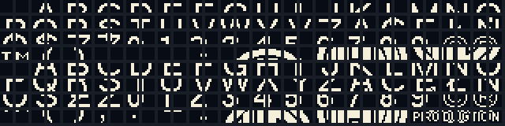

# Kult (v1)

`kult.asm` contains recovered runtime bytes at their actual CPU addresses.
`packed.asm` preserves every byte of the supplied executable, including its
loader and compressed streams. Run `../build.sh` to build and verify both.

## Loading

The XEX loads `$2B00-$B2FF`, the loader at `$BB00-$BC04`, and RUNAD `$BB02`.
The loader disables interrupts/video and reads an RLE stream through `$80/$81`.
`$BF` introduces a repeated byte and count; `$CF` introduces a run of zeroes.
Decoded headers contain destination and length; a length of `$FFFF` calls the
destination. A zero length restarts the loader using the pointer at `$BB00`.

The first pass writes the lower memory blocks and changes that pointer to the
second stream at `$8000`. The second pass loads RAM under the OS ROM, with
explicit PORTB writes. Recovery stops at the transfer to `$7FEE`: this small
stub survives in the original loaded buffer, clears POKEY and jumps to `$C000`.
The two passes produce 25 data blocks (including PORTB and loader-pointer writes).

`memory.bin` is the CPU recovery checkpoint, not a complete Atari save state.
`kult.bin` concatenates only the recovered ranges listed in `../analysis.json`;
it is not an executable XEX. `kult-packed.xex` is the byte-exact runnable archive.

## Established structure

| Address | Meaning |
|---|---|
| `$0300-$1780` | Lower runtime helper/data block; interpretation incomplete |
| `$2400-$4C4F` | Graphics/data blocks |
| `$4E75-$75A0` | Game state, graphics and tables; includes display-related data |
| `$C000`, `$C0EE` | Menu entry and setup |
| `$C126` | Menu loop; checks fire through TRIG0 |
| `$C271`, `$C281` | IRQ and NMI dispatch |
| `$C2C3` | Menu VBI: scrolling and music |
| `$C309` | Install vectors, disable OS ROM, configure display |
| `$C362`, `$C390` | Fade to black / selected palette |
| `$C3DD` | Two-frame wait with an intervening input update |
| `$C41B` | Select menu display list and DMA control |
| `$C581` | Menu display-list interrupt |
| `$C5A0` | Text renderer emitting two screen codes per character |
| `$C800-$CFFF` | 2 KB character graphics |
| `$D800-$FF11` | Multiple recovered code/data blocks, with gaps |
| `$E487` | Music update entry called by menu VBI |
| `$EA73` | Game display-list interrupt |
| `$F6E1`, `$F7C2` | Game initialization and main loop |

`NmiDispatch` copies shadow colours, DMA control and display-list addresses to
hardware, increments the frame clock, then calls VVBLKI. The gameplay initializer
clears `$7600-$BFFF`, resets sound/state and installs its display. Most individual
gameplay routines still use address-based labels; room/object meanings are not
claimed to be fully identified.

The atlas shows all 256 eight-byte units at `$C800`. Some glyphs are composed
from multiple units; this is a raw asset view, not a reconstructed game screen.
