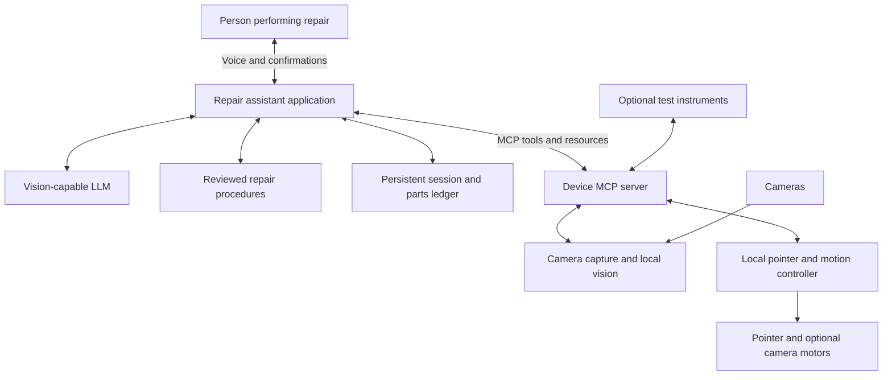

# AI Repair Assistant: Camera, Pointer, and Parts Mat

Concept and feasibility notes, researched on 7 September 2026.

This is a proposal for a separate project. The architecture and development stages below are engineering recommendations, not an implemented or tested system.

## Concept

Build a repair assistant that gives an AI a movable camera, a physical pointer, and a voice. A person performs the repair while the assistant observes, explains the next step, highlights the relevant screw or component, and remembers where removed parts were placed.

The proposed hardware resembles a desk lamp: a camera and light on an adjustable neck, with a laser pointer or another projection mechanism. A computer runs the AI application and communicates with the device through a Model Context Protocol (MCP) server.

A coordinate mat provides a shared reference system. Columns are labeled A, B, C, and so on; rows are numbered 1, 2, 3, and so on. For small repairs, put this mat on the workbench. A larger floor version could serve larger equipment later.

An example interaction:

1. The assistant identifies the device and loads the matching repair procedure.
2. It highlights a screw and says, “Remove this screw, then place it in B3.”
3. The person removes the screw and confirms completion.
4. The assistant checks a fresh camera image and records the screw's original location and storage cell.
5. It guides the next removal or measurement.
6. During reassembly, it says, “Take the screw from B3 and return it to the highlighted hole.”

## Overall assessment

A useful prototype for a small set of known repairs is realistic. A dependable assistant for arbitrary broken objects is a much larger research and product-development challenge.

The main difficulty is reliably connecting a repair instruction to the correct physical part, then verifying what actually happened. The camera, voice interface, coordinate mat, and MCP connection are more straightforward components.

Keeping the person responsible for handling tools substantially reduces the mechanical scope. The system still needs strong perception, repair knowledge, and a way to pause when the evidence is insufficient.

## Most difficult parts

| Area | What makes it difficult | Recommended first approach |
| --- | --- | --- |
| Repair reasoning | Similar models can have different screws, clips, wiring, and disassembly sequences. Visible symptoms may have several causes. | Support one exact device model and a reviewed procedure. |
| Identifying the correct part | Several screws may look identical; hands, tools, shadows, and reflections obscure details. | Use controlled lighting, close-up images, and explicit target confirmation when ambiguous. |
| Accurate physical pointing | An image location must become a position on a real, three-dimensional object. Movement invalidates old coordinates. | Begin with screen annotations; add calibrated physical pointing as a separate milestone. |
| Tracking repair progress | An instruction being spoken does not prove that the action happened. | Track expected changes and compare fresh observations with human confirmations. |
| Remembering removed parts | Screws can roll, overlap, or be moved while hidden by a hand. | Use labeled compartments and persist a parts ledger with photos. |
| Moving the camera | A moving viewpoint changes perspective and can lose sight of the workspace. | Start with a stable overhead camera and a manually positioned close-up camera. |
| Electrical diagnosis | A camera cannot directly measure voltage, resistance, or continuity. | Record readings from a person or connected instrument, including units and test conditions. |

### Repair knowledge and uncertainty

Use a reviewed service procedure as the backbone of each supported repair. The AI can explain steps, answer questions, and interpret observations, but each action should remain tied to the identified model and the current repair state.

For every step, store prerequisites, the target part, the required action, the expected result, and the evidence needed to proceed. An unexpected connector, missing screw, or different internal layout should trigger a fresh inspection.

Treat model confidence as a signal to investigate, not proof that a target or diagnosis is correct. Support responses such as “I cannot distinguish those two screws; move the camera closer.”

Reassembly needs its own procedure: screw locations, cable routing, tightening instructions, and replacement consumables may matter. Simply reversing the disassembly transcript is insufficient.

### Pointing at the correct screw

Calibration establishes how camera observations relate to the pointer and workspace. A mapping calibrated on a flat mat applies to that plane; it does not automatically place a dot correctly on a screw several centimeters above it.

For targets at different heights, investigate depth sensing, known object geometry, or visual feedback that observes the projected spot and corrects its position. A practical pointer will likely combine initial calibration with local feedback.

The proposed control sequence is:

1. Acquire a fresh frame and locate the target.
2. Check that the current camera and workpiece positions are known.
3. Calculate a permitted pointing position.
4. Activate the pointer briefly and inspect where its spot actually appears.
5. Correct or reject the result before telling the person to act.
6. Invalidate the target when the object moves or tracking is lost.

This feedback loop belongs in local control software. The LLM should request a target; it should not generate a continuous stream of motor adjustments.

Reflective metal is a material consideration for a laser-based design: reflected beams can create eye hazards. A projected marker from an LED projector is worth evaluating. If a laser is retained, its optical design and operating limits need assessment; downward aiming alone does not address reflections. [FDA guidance on laser reflections](https://www.fda.gov/consumers/consumer-updates/laser-toys-how-keep-kids-safe).

## Camera neck and movement

There are two different interpretations of the flexible neck:

- **Manually positioned gooseneck:** The person bends it into position, like a lamp. This is a reasonable prototype option if it holds the camera steadily. Software must reacquire the workspace after repositioning.
- **Motorized flexible neck:** The AI bends the neck automatically. This adds substantial mechanical and control work, including actuation, shape estimation, stiffness, cable routing, and repeatable positioning.

For an early motorized version, I would choose a rigid mount with a pan-and-tilt head. It has fewer moving variables and is easier to calibrate. Pan and tilt change viewing direction; seeing behind a component may still require physically relocating the camera.

Two cameras are worth considering: one fixed overhead camera retains the full view of the mat and device, while a second camera provides close-ups. If the pointer is mounted beside the close-up camera, keep their relative mounting rigid even when the support moves.

## Coordinate mat and parts memory

The coordinate mat is a useful part of the idea because it makes instructions concrete and helps preserve the history of the repair.

Proposed features:

- Clear row and column labels readable by the person.
- A matte surface with good contrast against small parts.
- Shallow compartments or removable labeled trays to prevent rolling and mixing.
- Printed visual markers around the perimeter so software can locate the mat.
- A defined orientation, so B3 always means the same physical cell.

ArUco markers are one candidate for visual registration. With camera calibration and known marker dimensions, they support estimating a marker's pose. This provides a basis for locating the mat; it does not itself identify loose screws. [OpenCV ArUco documentation](https://docs.opencv.org/4.x/d5/dae/tutorial_aruco_detection.html).

Store the parts ledger in a database or file outside the conversation history. An illustrative record could contain:

| Field | Example |
| --- | --- |
| Part ID | `screw_007` |
| Removed during | Step 4 |
| Original location | Rear cover, upper-left mounting hole |
| Storage location | B3 |
| Description | Black screw; dimensions not yet measured |
| Evidence | Before-removal photo and placement photo |
| Status | Placement confirmed by operator; visually observed |

Do not silently infer that a screw reached B3 just because that instruction was issued. If placement was hidden, ask for confirmation or another view and preserve the uncertainty in the record.

## Proposed software architecture

MCP is suitable for exposing device capabilities as tools and observations as resources. The host application coordinates the model and MCP connections. [MCP architecture specification](https://modelcontextprotocol.io/specification/2025-06-18/architecture).

The following are proposed application tools, not standard MCP functions:

| Tool | Purpose |
| --- | --- |
| `capture_frame(camera_id)` | Return a fresh image with a timestamp and frame ID. |
| `locate_workspace()` | Return the mat's detected position and registration status. |
| `point_at(target_id, frame_id, duration_ms)` | Request pointing at a validated target from a recent observation. |
| `pointer_off()` | Stop pointer output immediately. |
| `get_repair_state()` | Retrieve the current step, evidence, and unresolved observations. |
| `record_part(part_id, cell, evidence)` | Save a placement with its supporting evidence. |
| `read_instrument(instrument_id)` | Retrieve a reading, unit, and instrument status when supported. |

Tool results should distinguish completed actions from rejected requests. An old frame, lost target, or invalid calibration should produce a rejection that the application can explain.

Use a separate media path for continuous audio or video if needed. MCP can handle commands and selected observations without serving as the motor-control loop or the entire media pipeline. Keep pointing timeouts and stopping behavior local so they continue to work during network or model delays.

## Practical development stages

### Stage 1: Guided repair with a stationary camera

Use an existing computer, a close-focusing camera on a stable stand, diffuse lighting, a microphone and speaker, and a printed coordinate mat with small trays.

Choose one known device and one repeatable procedure, such as opening a disconnected computer mouse, inspecting a specified component, and reassembling it. Prepare reference photos and review the procedure before testing.

Implement voice instructions, images annotated on a screen, step confirmation, and a persistent parts ledger. This stage tests whether the assistant can follow the repair accurately and retain useful state.

### Stage 2: Physical pointing

Add a projector or a suitably designed steerable pointer. Initially keep the camera, workpiece, and target surface fixed. Measure pointing error, then test raised targets, workpiece movement, occlusion, and reflections before expanding the operating area.

A reasonable acceptance goal is that the marker unambiguously identifies the intended screw under defined conditions. Derive the required accuracy from the smallest target and spacing between neighboring parts, rather than choosing an arbitrary millimeter specification.

### Stage 3: Better views

Add a second close-up camera or a motorized rigid camera head. Preserve the overhead view for parts tracking. Require reacquisition after movement and test recovery when hands or tools obscure the target.

### Stage 4: More repairs and measurements

Expand the reviewed procedure library, add exact model identification, and integrate test instruments where useful. Record measurement units and conditions. Evaluate each new repair workflow separately; success on one device does not establish general repair competence.

## Difficulty and validation

These are qualitative engineering estimates, not delivery commitments:

| Deliverable | Expected difficulty |
| --- | --- |
| Camera, voice, and a scripted procedure | Moderate integration project |
| Coordinate mat with confirmed parts logging | Moderate |
| Reliable pointing on a fixed, known surface | Moderate to high |
| Precise pointing on moving, three-dimensional objects | High |
| Automatic camera repositioning around clutter | High |
| Motorized flexible neck | High mechanical and control complexity |
| Reliable diagnosis and guidance for arbitrary devices | Very high; substantial unresolved scope |

Before selecting detailed hardware or estimating a schedule, define the supported object sizes, smallest target, camera working distance, permitted movement, repair category, and computing arrangement.

Prototype evaluation should include ordinary interruptions and mistakes:

- The person removes a different screw or places it in a different cell.
- A hand hides an action, or two similar parts overlap.
- The device or camera moves after a target is selected.
- A session resumes after the application restarts.
- Voice recognition mishears “done,” or a tool fails to respond.
- The observed device differs from the reference procedure.

Measure wrong-target selections, pointing error, incorrect step advancement, parts-ledger accuracy, response latency, and successful recovery from uncertainty. A convincing demonstration and a dependable repair tool require different amounts of validation.

## Existing related systems

### LightGuide: projected work instructions

LightGuide markets workstations that project instructions onto a workspace. Its smartAR Desktop includes a projector and a 3D camera and is described for small-part assembly, inspection, and repair. This is a close commercial precedent for the visual-guidance portion of the concept. [LightGuide smartAR Desktop](https://www.lightguidesys.com/smart-ar-desktop/).

Its rack-server repair demonstration describes barcode-selected workflows, projected instructions, step inspection, and illuminated parts bins. These are manufacturer-described capabilities; the demonstration does not establish autonomous diagnosis of arbitrary devices. [LightGuide rack-server repair demonstration](https://www.lightguidesys.com/resource-center/video/ar-guided-rack-server-refurbishment/).

### Periscope: a robotic camera for remote assistance

Periscope is a 2023 research prototype with a camera on a semi-autonomous robotic arm. A remote human helper guides a local worker, and camera control can be shared between the participants and robot. The paper reports a preliminary assembly study involving 12 pairs of participants. It is a useful precedent for camera movement and collaboration, with a human supplying the guidance. [Periscope research paper](https://arxiv.org/abs/2305.07517).

The sources reviewed establish precedents for projected guidance, parts-bin indication, and robotic camera assistance. They do not establish an exact commercial match for the complete proposed combination of an LLM, movable camera, physical pointer, conversational diagnosis, and persistent coordinate-based parts tracking. This was a targeted search, not an exhaustive market or patent survey.

## Recommended first milestone

Demonstrate one complete repair session on a known device: the assistant identifies the next target, gives a clear instruction, records each removed part in its actual compartment, handles an interruption, and guides correct reassembly.

Use that experiment to decide whether physical pointing or better camera access produces the greatest improvement. The result should guide the mechanical design and the scope of the next prototype.
